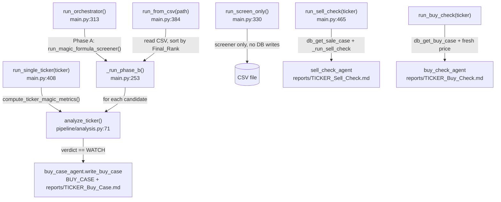

# Orchestration & CLI Walkthrough

Primary files: [`src/main.py`](../src/main.py) (838 lines) and
[`src/pipeline/`](../src/pipeline/). There is no separate "orchestrator agent"
object; five `LlmAgent`s are built once at import time, and `main.py`'s
`if __name__ == "__main__"` block dispatches to one of five run functions based on
CLI flags.

> **The code moved; the call paths did not.** `main.py` used to hold all of this in
> one 3,000-line file. The agents are now in [`src/agents/`](../src/agents/), the
> report sections in [`src/report/`](../src/report/), the cost accounting in
> `src/usage.py`, config in `src/settings.py`, and the run machinery —
> `analyze_ticker`, the agent loop, the reuse fingerprint, verdict parsing — in
> [`src/pipeline/`](../src/pipeline/). `main.py` re-exports all of it, so
> `main._analysis_key` and friends still resolve exactly as written below, and what
> is left in `main.py` itself is the CLI and the workflows that choose which tickers
> to run. See [00-module-map.md](00-module-map.md). Line numbers in this document
> predate the split — search for the symbol name, per the convention note in
> [README.md](README.md).

> **There are three more entry points.** [`src/sale_advisory.py`](../src/sale_advisory.py)
> regenerates a Phase C sale advisory for any stored report
> ([10-sale-advisory-regeneration.md](10-sale-advisory-regeneration.md)) — the repair
> tool for a run whose advisory is missing, stale, or was skipped. And
> [`src/refine.py`](../src/refine.py) runs the
> opt-in Phase D critic loop (`python refine.py TICKER`) and is documented in
> [09-critic-and-refinement-loop.md](09-critic-and-refinement-loop.md). And
> [`src/buy_case.py`](../src/buy_case.py) generates or repairs a Phase E buy case for
> any stored `Watch` report ([11-buy-case-and-buy-check.md](11-buy-case-and-buy-check.md)).
>
> **None of them import `main` any more, and that is a recent change.** They used to,
> for the agents, the cost accounting and a configured logger — which made `main` a
> module that imported its own importers. Because `main.py` is run as a script it
> loads under the name `__main__`, so a later `import main` did not find it in
> `sys.modules` and executed the whole file a SECOND time: a second config read, a
> second set of agent objects, and a second pair of log handlers on one logger, so
> every line printed twice and the run split across two files. A
> `sys.modules.setdefault` at the top aliased the two names to paper over it.
>
> That is gone. Everything shared moved to `settings`, `agents`, `usage`, `report`,
> `pipeline`, `persistence` and `run_log`, and these commands import from there. The
> logging knot was the load-bearing one — `logger = main.logger` is why importing the
> CLI was unavoidable — and `run_log` now owns that, with its own guard against
> configuring the logger twice.
>
> There are now no mutual imports anywhere in `src/`. `pipeline/analysis.py` still
> imports `buy_case_agent` inside the function, but only to avoid loading it on the
> runs that never reach Phase E — not to break a cycle. Everything below concerns
> the six modes of `main.py` itself.

## 1. Startup (module load), `main.py:1-250`

Runs once, before any CLI parsing. Most of it is now imports: `main` pulls the
shared machinery in from the modules that own it and re-exports it, so the list
below is as much a map of where things live as a sequence of events.

- `main.py:37-62` imports every MCP tool wrapper from `mcp_server.py`. This no
  longer bootstraps the database — `initialize_database()`
  (`persistence/db.py:47`) fires lazily, on the first connection that needs one.
- `main.py:73` imports `run_log`, which sets up dual logging (console +
  `logs/run_<timestamp>.log`) and guards against doing it twice.
- `main.py:102-125` imports `settings`, which is what reads
  `src/specs/config.yaml` (`settings.py:27`) — including `top_n_candidates`
  (`settings.py:31`, overridable by `--top-n`) and the LLM/embedding/Tavily
  pricing tables (`settings.py:64-76`).
- `settings.py:58` pins `AGENT_MODEL` from `config.yaml`'s `agents.model` —
  deliberately not the moving `gemini-flash-latest` alias (see
  [05-guardrails-cost-and-reuse.md](05-guardrails-cost-and-reuse.md)).
- `main.py:137-152` imports the agents, `main.py:163-176` the cost accounting,
  `main.py:199-224` the pipeline, `main.py:236-260` the report sections.
- Agent instructions are no longer read here at all. They live one file per agent
  in [`src/prompts/`](../src/prompts/) and are composed by `prompt_loader`
  (`prompt_loader.py`), which `agents/definitions.py` calls as it builds each
  agent. `prompts/buy-case.md` is read separately for the reuse fingerprint
  (`_DOWNSTREAM_PROMPTS`, `pipeline/reuse.py:57`): its agent lives in
  `buy_case_agent.py`, which imports from `pipeline`, so the fingerprint reads the
  FILE rather than the agent — see
  [05-guardrails-cost-and-reuse.md](05-guardrails-cost-and-reuse.md).

## 2. Agent definitions, `agents/definitions.py`

Five of the seven `LlmAgent`s (`bear_agent`, `bull_agent`, `analyst_agent`,
`sale_advisor_agent`, `sell_check_agent`) are constructed here, once, at
import time — not per-run. The other two, `buy_case_agent` and `buy_check_agent`,
live in [`src/buy_case_agent.py`](../src/buy_case_agent.py) because Phase E is
conditional on a verdict this module parses *after* the graph has run. See
[02-agents-and-reasoning-graph.md](02-agents-and-reasoning-graph.md) for the
prompt content; this doc only covers control flow.

`PIPELINE_AGENTS = [bear_agent, bull_agent, analyst_agent, sale_advisor_agent]`
(`main.py:462`) is the ordered list `_run_pipeline_async` walks. It is a plain
Python list, not ADK's `SequentialAgent` class — see §3 below for why.

## 3. Running the reasoning graph, `pipeline/execution.py:43-135` (`_run_pipeline_async`)

This is the function every Phase B/C run eventually calls. Per ticker:

1. Creates one `InMemorySessionService` session keyed `f"{run_id}:{ticker}"`
   (`pipeline/execution.py:52-82`) and seeds it with `ticker`, `company_name`, `sec_data`,
   `metrics_data`, `quarterly_data`, `verified_figures`, `screen_context`.
2. Builds the agent list, dropping `sale_advisor_agent` if
   `skip_sale_advisor` (`pipeline/execution.py:84-85`).
3. For each agent in order (`pipeline/execution.py:86-128`):
   - Builds a fresh `Runner` via `_build_runner` (`agents/runtime.py:78-87`, attaches
     context-cache config from `App` if `CONTEXT_CACHE_ENABLED`).
   - Runs it against the shared session; the agent's `output_key` (e.g.
     `"bear_data"`) writes its answer into session state.
   - **Retries only that agent** on a 429 (`pipeline/execution.py:103-118`, up to
     `MAX_AGENT_RETRIES = 5` with exponential backoff from
     `BASE_BACKOFF_SECONDS = 20`). This is the reason the graph is a manual
     list instead of ADK's `SequentialAgent`: retrying the *whole* graph on a
     late rate limit used to re-run (and re-pay for) every already-completed
     role — see `pipeline/execution.py:41-51` and
     [agent_architecture.md §5B](../src/specs/agent_architecture.md).
4. Returns `(final_session_state, usage)`.

`run_pipeline` (`pipeline/execution.py:138-156`) is the synchronous wrapper (`asyncio.run`)
that `analyze_ticker` calls; it adds one gentle inter-ticker sleep afterward.

## 4. Per-ticker orchestration, `pipeline/analysis.py:71-363` (`analyze_ticker`)

The single function every execution mode funnels through for Phase B/C. In order:

1. **Normalize the candidate shape** (`report/figures.py:53`, `_normalize_candidate`) —
   screener-CSV rows and on-demand single-ticker rows use different field
   names/types; see [05-guardrails-cost-and-reuse.md](05-guardrails-cost-and-reuse.md).
2. **Reuse check** (`pipeline/analysis.py:96-129`) — before any billed work, look up
   `db_find_reusable_report` by `analysis_key` (a hash of ticker + balance-sheet
   date + prompt version). On a hit, copy the prior run's DB rows
   (`db_copy_ticker_outputs`) and the report file, then return zero usage —
   **no LLM call happens at all**.
3. **Direct data gathering** (`pipeline/analysis.py:131-157`, no LLM, no tokens):
   `fetch_sec_10k_data`, `fmp_metrics_extractor`, `fmp_quarterly_trends`,
   `_price_snapshot`, `_format_verified_figures`. Logs a warning if the candidate is
   missing the debt/cash/EV columns the reconciliation gate needs. The price snapshot
   is fetched **once** here and reused by the report's `## Price` section, the agents'
   `VERIFIED_FIGURES`, and the buy case — so all three quote one number.
4. **Run the reasoning graph** (`pipeline/execution.py:138-156`, calls `run_pipeline` from §3).
5. **Persist everything** (`pipeline/analysis.py:181-296`):
   - `db_store_agent_output` for `SEC_DATA`/`QUANT_METRICS` (unembedded) and
     `BEAR_CASE`/`BULL_CASE`/`SALE_CASE` (embedded).
   - Run the **reconciliation gate** (`_reconcile_agent_figures`, `report/reconciliation.py:225-306`)
     over bear/bull/final/sale text against the verified figures.
   - Extract the verdict (`_extract_verdict`, `pipeline/verdict.py:34-47`) and prepend
     the deterministic `## Magic Formula Metrics` section
     (`_format_magic_formula_section`) plus any reconciliation warnings.
   - `db_store_final_report`, `db_store_ticker_run`, and write
     `reports/{TICKER}_Final_Report_{Verdict}.md` /
     `reports/{TICKER}_Sale_Advisory.md`. The stored report opens with a
     deterministic `## Price` table (`_format_price_section`) above the Magic Formula
     section — what a share cost, when, and where that sits in its 52-week range.
   - **Phase E, `Watch` only.** With the report already persisted, `analyze_ticker`
     asks `buy_case_agent.is_watch(verdict)` and, if so (and unless
     `--skip-buy-case`), calls `buy_case_agent.write_buy_case` to add a `BUY_CASE`
     and `reports/{TICKER}_Buy_Case.md` to the same run. Any other verdict logs the
     reason and writes nothing — an absent buy case on a `Buy` is a decision, not a
     failure. See [11-buy-case-and-buy-check.md](11-buy-case-and-buy-check.md).

## 5. The six execution modes, `main.py:253-676`

- **`run_orchestrator(force, skip_sale_advisor)`** (`main.py:313`) — Phase A
  then `_run_phase_b`. Bare `python main.py`.
- **`run_screen_only()`** (`main.py:330`) — Phase A alone; writes the CSV,
  logs the top N, and returns. No `pipeline_runs` row, no agent calls.
- **`run_from_csv(csv_path, force, skip_sale_advisor)`** (`main.py:384`) —
  reads the rankings CSV (sorted by `Final_Rank` if present), takes the top
  `top_n`, calls `_run_phase_b`.
- **`run_single_ticker(ticker, company_name, force, skip_sale_advisor)`**
  (`main.py:408`) — no screener; calls `compute_ticker_magic_metrics` for the
  bull/bear value signal, then `analyze_ticker` directly.
- **`run_sell_check(ticker, company_name, run_id)`** (`main.py:465`) —
  standalone Phase C follow-up; loads a stored `SALE_CASE`
  (`db_get_sale_case`), fetches current FMP metrics + quarterly trends, runs
  `sell_check_agent` via `_run_sell_check` (`pipeline/execution.py:191`), writes
  `reports/{TICKER}_Sell_Check.md`. Creates **no** `pipeline_runs` row.
- **`run_buy_check(ticker, company_name, run_id)`** — the mirror image, a Phase E
  follow-up for a stock you do **not** own: loads a stored `BUY_CASE`
  (`db_get_buy_case`), fetches **today's price** plus metrics and quarterly trends,
  runs `buy_check_agent`, writes `reports/{TICKER}_Buy_Check.md` (`BUY`/`WAIT`). Also
  creates no `pipeline_runs` row. See
  [11-buy-case-and-buy-check.md](11-buy-case-and-buy-check.md).

`_run_phase_b(top_candidates, source_label, force, skip_sale_advisor, skip_buy_case)`
(`main.py:253`) is shared by `run_orchestrator` and `run_from_csv`: it
creates the parent `pipeline_runs` row (`db_create_pipeline_run`, must happen
**before** any `agent_outputs`/`final_reports` insert — those tables carry an
FK onto it), then loops candidates through `analyze_ticker`, checking the
budget guard (`_check_budget`, `usage.py:60`) before each one.

## 6. CLI argument parsing, `main.py:678-825`

Standard `argparse`. Notable validation, not just flag definitions:

- `--run` is rejected unless paired with `--sell-check` or `--buy-check`.
- `--sell-check` and `--buy-check` are rejected together: they test different stored
  conditions for opposite readers, and each writes its own report file, so one
  invocation would be ambiguous about which answer it was reporting.
- `--screen-only` rejects being combined with any Phase B/C/E flag (`--from-csv`,
  `--sell-check`, `--buy-check`, `--skip-sale-advisor`, `--skip-buy-case`, `--force`,
  or a bare `TICKER`) rather than silently ignoring them.
- `--skip-sale-advisor` is rejected with `--sell-check`, and `--skip-buy-case` with
  `--buy-check` — neither check flow runs the phase its flag would skip.
- Dispatch is a simple if/elif chain checking `--screen-only` → `--sell-check` →
  `--buy-check` → `--from-csv` → `TICKER` → bare `run_orchestrator()`.

## Where to look next

- Agent prompts and the exact state keys each one reads/writes:
  [02-agents-and-reasoning-graph.md](02-agents-and-reasoning-graph.md).
- What `fetch_sec_10k_data` / `fmp_metrics_extractor` / `fmp_quarterly_trends`
  actually return: [03-mcp-tools-and-persistence.md](03-mcp-tools-and-persistence.md).
- `_analysis_key`, `_check_budget`, `_reconcile_agent_figures`, and the cost
  accounting functions: [05-guardrails-cost-and-reuse.md](05-guardrails-cost-and-reuse.md).
- What happens after `analyze_ticker` stores a `Watch` report, and the `--buy-check`
  command that reads it back: [11-buy-case-and-buy-check.md](11-buy-case-and-buy-check.md).
