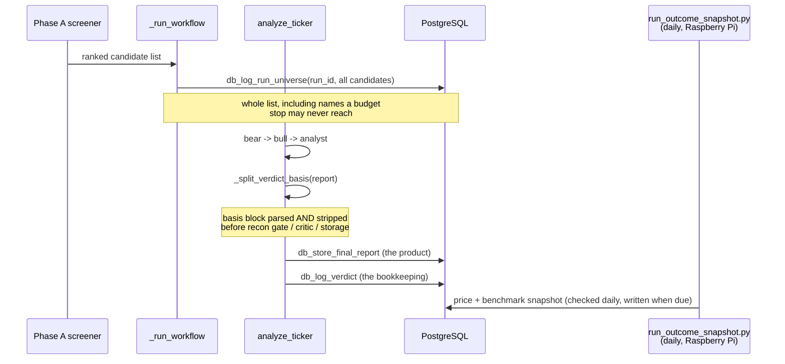

# The Verdict Ledger

Everything else in this system records what a run **produced**. The ledger
records what a verdict **claimed** and what the stock did afterwards, so the
system can eventually be graded on realised outcomes instead of on its own
confidence.

It changes no verdict today. Phase 1 only writes things down — deliberately, because
the value of a track record is a function of elapsed time and nothing else, and
every month not logged is a month that cannot be recovered later.

> **What this is not.** It is not a memory that feeds back into a prompt. Nothing
> in these tables is read by any agent, and no agent has any of the ledger's
> tools in its `tools=[...]`. `critic_memory` is the system's one true feedback
> memory (see [09-critic-and-refinement-loop.md](09-critic-and-refinement-loop.md));
> the ledger is a record, not an input.

## What it is for, in order of when it pays off

1. **Did filtering the screen beat not filtering it?** The Magic Formula is a
   basket method; its edge comes from holding many screened names, including
   uncomfortable ones. A bear/bull/analyst chain is structurally best at building
   an articulate case *against* the cheapest names, so it is a live question
   whether the agents' filter adds or subtracts. Answering it needs a
   point-in-time price for the names the agents passed over as well as the ones
   they liked — which is why `run_universe` records the whole screen output and
   `verdict_outcome` tracks names nobody bought. **One year of data, zero extra
   cost.**
2. **Which factors do we read well, and which do we misread?** Aggregating on
   `verdict_basis.factor_key` across every ticker reaches useful sample sizes far
   sooner than any company-to-company comparison could, and the lessons
   generalise across sectors.
3. **Does the critic change outcomes, or only cost money?** `verdict_stage`
   records the independent verdict and the post-refinement one separately.
   `refine.py` writes the `POST_CRITIC` row, and only when the review actually
   moved the verdict or revised the report — a refinement that agreed and changed
   nothing would otherwise add a duplicate saying so and dilute every rate computed
   over the table. The `INDEPENDENT` row is never amended: grading the refined call
   needs the pre-critic call still standing beside it against the same prices, so
   overwriting it would delete the control group.

   Expect this to fill slowly. On the history to date **1 refinement in 9 has
   changed a verdict**, and refinement is an opt-in command run on a handful of
   names. These rows are a case file — "was the critic right to move this one?" —
   long before they are a dataset. The faster read on whether the critic earns its
   cost is `critic_memory`: findings accumulate every review, and most of the
   critic's value arrives as corrected reasoning that never changes the label.

A fourth use — a second verdict informed by 1 and 2 — is deliberately unbuilt.
It needs a few hundred verdicts with real elapsed time behind them, and shipping
it early would produce a confident-sounding section resting on noise.

## The four tables

Full DDL and rationale live in [`src/sql-schema.sql`](../src/sql-schema.sql)
(tables 6–9); `initialize_database()` in `mcp_server.py` mirrors it idempotently,
as it does for every other table.

| Table | One row per | Written by | When |
| :--- | :--- | :--- | :--- |
| `run_universe` | candidate that cleared the screen | `db_log_run_universe` | once per run, before any agent runs |
| `verdict_log` | fresh verdict | `db_log_verdict` | end of `analyze_ticker` |
| `verdict_basis` | factor behind a verdict | `db_log_verdict` | same call |
| `verdict_outcome` | daily price snapshot | `cron/run_outcome_snapshot.py` | daily cron, off-box (writes per subject every `snapshot_interval_days`, 1 by default) |

**None of them carry a foreign key onto `pipeline_runs`.** Every other table in
the schema cascades away with its run, which is right for per-run artefacts.
These are memory: a verdict whose run was deleted is still a verdict that was
made, and losing it would silently shorten the very track record they exist to
accumulate. The run ids are provenance, not constraints. Same reasoning as
`critic_memory`.

## Two design rules that explain most of the code

**Grading is arithmetic, never a model.** A price return minus a benchmark
return is subtraction. Handing that to an LLM introduces hindsight bias and a
systematic pull toward self-flattery — the model would be scoring its own prior
output. `run_outcome_snapshot.py` contains no LLM and no prompt.

**The factor vocabulary is controlled, not free text.** `factor_key` comes from
`verdict_ledger.factor_taxonomy` in [`config.yaml`](../src/specs/config.yaml).
Free-form keys were the alternative and would have made the table useless for its
one purpose: "customer concentration", "client concentration risk" and "top-10
customer exposure" are one factor written three ways, and as three distinct keys
they never accumulate into a base rate. A factor the analyst reaches for that is
not on the list is stored as `OTHER_<name>` and reviewed for promotion — kept,
not dropped, because a lost observation is unrecoverable and an untidy key is
just a rename.

The taxonomy deliberately **excludes the screen's own entry criteria** (high
return on capital, high earnings yield, low PEG, EPS growth). Every candidate has
those, so recording them would swamp the base rates with a constant that
distinguishes nothing. `test_verdict_ledger.py` asserts they stay out.

## Where it hooks into a run



### The basis block, and why it is stripped

`VERDICT_BASIS_MANDATE` (`main.py`) asks the analyst for a final
`## Verdict Basis` section containing one fenced ```json block: 3–7 objects of
`{factor_key, stance, materiality, observation}`.

`_split_verdict_basis` parses it and **removes it from the report**, before the
reconciliation gate, the critic, the stored report or the web UI see the text.
The report is written for a reader with no finance background; a JSON array at
the foot of it is noise to every human who opens it.

The parser degrades in one direction only. A missing section, an unfenced array,
a malformed object, a JSON object where an array was expected — each costs the
ledger its factors and leaves the report entirely intact. **The analysis is the
product; the bookkeeping is not.** The same principle governs the write: the
`db_log_verdict` call is wrapped in its own `try/except` and is *not* routed
through `_check_db`, so a ledger failure can never fail a run that has already
been paid for.

### What only gets logged once

`db_log_verdict` is reached only on the **fresh-analysis path**. The reuse path
(`db_find_reusable_report` → `db_copy_ticker_outputs`) returns long before it,
and that is load-bearing: copying a prior report into a new run re-states an
existing judgement rather than making a new one. Logging it again would enter the
same observation into the track record twice, and one heavily re-run ticker would
then dominate every base rate computed from the ledger. FISV alone has 15 stored
reports.

For the same reason, a legacy `HOLD`/`SELL` or an unparsed verdict is **not**
logged at all rather than being coerced into a bucket. A wrong label is worse for
a track record than a missing row.

## The snapshot job (cron runs daily)

[`src/cron/run_outcome_snapshot.py`](../src/cron/run_outcome_snapshot.py) is
built to run **somewhere other than the machine that runs the agents** — it needs
no LLM, so any always-on box that can reach the database will do (a Raspberry Pi
is the case this was written for).

```bash
0 18 * * * /path/to/magic-stock-picker/.venv/bin/python /path/to/magic-stock-picker/src/cron/run_outcome_snapshot.py
```

The cron fires every day, and `verdict_ledger.snapshot_interval_days` is set to
match (1 by default), so every open subject gets a fresh snapshot every day —
that's what a daily dashboard needs. The two remain independent knobs: raise
the interval (7, for weekly) if daily granularity isn't needed and cutting FMP
call volume matters more. Either way, running the cron daily costs nothing
extra by itself — a subject not yet due is skipped without an FMP call.

It **imports nothing from the rest of this repo.** `main.py` and `mcp_server.py`
pull in google-adk, pandas, edgartools and the Gemini SDK; none of that is needed
to fetch quotes and subtract, and installing it on a Pi means building pandas
from source for no benefit. So the job talks to PostgreSQL and FMP directly and
duplicates a ~15-line quote helper. **That duplication is deliberate** — see the
module docstring. Its dependencies are in
[`requirements-cron.txt`](../requirements-cron.txt): `requests`,
`psycopg2-binary`, `python-dotenv`, `pyyaml`. It needs `DATABASE_URL` and
`FMP_API_KEY` and nothing else.

It sends **no notifications**. A price being recorded is not news, and an
alerting scoreboard trains its reader to ignore it. (The tracker repo owns the
Pushover/Plunk channel for things that *are* news.)

### Deploying it on a Pi that already runs the viewer

**Do not assume the Pi has a git checkout.** The viewer is deployed there by
copying `webapp/` across, so `src/` may exist but be empty and there may be no
`.git` at all. `git pull` is not the install path.

What the job actually needs is two files, and it finds both by walking up from
its own `__file__`:

| File | Required? | Why |
| :--- | :--- | :--- |
| `src/cron/run_outcome_snapshot.py` | yes | the job |
| `src/specs/config.yaml` | optional | benchmark symbol, interval, tracking window |

With `config.yaml` absent the job logs a WARNING naming the built-in defaults it
fell back to (`SPY`, 7 days, 400 days) and carries on, so a one-file copy still
works. It is a warning rather than a silent default because a Pi quietly
benchmarking against a different symbol than the config says is exactly the kind
of divergence that hides for months. A config file that exists but does not parse
is a hard error instead — running against settings nobody chose, while the file
meant to govern the job sits there broken, is worse than stopping.

Three other things are still missing, and all three are easy to miss because the
viewer does not need any of them.

**1. Two packages.** The viewer installs `flask, psycopg2-binary, python-dotenv,
markdown`; this job also needs `requests` and `pyyaml`. Install the cron subset,
never the root `requirements.txt` — that one pulls google-adk, pandas and
edgartools, and building pandas on a Pi is a long wait for code this job never
runs:

```bash
cd ~/magic-stock-picker
pip install -r requirements-cron.txt
```

**2. An FMP key.** The viewer only reads the database, so a Pi set up for it has
no `FMP_API_KEY` at all. This job quotes prices and cannot work without one.

**3. Somewhere for both to live.** The job reads the repo-root `.env` first, then
falls back to `webapp/.env` — which on a viewer-only Pi is the only one that
exists and already holds a working `DATABASE_URL`. So adding the key to that
existing file is enough, and avoids a second copy of the same connection string
in a second file:

```bash
echo 'FMP_API_KEY=your_key_here' >> ~/magic-stock-picker/webapp/.env
```

`preflight()` checks both variables before any work starts and names the missing
one, the files it looked in, and why the viewer would not have had it. Without
that, a missing `DATABASE_URL` surfaces as `psycopg2.connect(None)` complaining
about a host, at 18:00, in a log nobody has a reason to open — so the cost of a
misconfiguration is not one failed run but however long it takes before somebody
notices the scoreboard stopped moving.

**Then verify by hand before scheduling anything:**

```bash
cd ~/magic-stock-picker && python3 src/cron/run_outcome_snapshot.py
```

An empty ledger prints `No ledger subjects due for a snapshot. No API calls
made.` and exits 0 — that is a pass, not a failure.

**Finally, the crontab** (`crontab -e`), daily after the close:

```
0 18 * * * cd /path/to/magic-stock-picker && /usr/bin/python3 src/cron/run_outcome_snapshot.py >> /path/to/magic-stock-picker/logs/cron-stdout.log 2>&1
```

The `cd` is belt-and-braces — the script resolves its own paths from `__file__`,
so it does not depend on the working directory, but a wrong cwd is the classic
cron failure and the guard costs nothing. The redirect catches anything that
fails *before* logging is configured (a missing interpreter, a syntax error);
everything after that point already goes to `logs/cron.log`.

Use `/usr/bin/python3` explicitly. Cron runs with a minimal PATH, and `python3`
alone is the second-classic cron failure.

**Rolling per-subject interval, not fixed 30/90/180/365-day horizons.** Fixed
horizons lose a datapoint permanently whenever a run is missed on the day a
horizon falls, and over a year a missed run is a certainty rather than a risk.
"Due" is defined against the last snapshot rather than against a schedule, so a
job that misses an interval catches up on its next run. The horizon marks are
derived from `age_days` at read time. `snapshot_interval_days` is set to 1 by
default now, matching the cron's own daily cadence, so every open subject gets
a fresh price every day — raise it (7, for weekly) if daily granularity is not
needed and cutting FMP call volume matters more.

**One quote call per symbol, deliberately.** `/stable/quote` does not batch: a
comma-separated list returns HTTP 200 with an empty array — success-shaped, and
it would write a whole interval of nothing while logging no error. The real
batch endpoints answer 402 Restricted on the Starter plan. A few hundred single
calls a day is nothing against the 300-calls-per-minute quota; a silently empty
scoreboard is the one
failure this job cannot afford, because nobody is watching it.

## Why a snapshot row has two parent columns

Every `verdict_outcome` row points at exactly one parent, and which one says what is
being priced:

```
ticker  verdict_id   universe_id
CROX    NULL         87a03460      <- a screened name
HRB     1ecdbf54     NULL          <- a verdict we gave
```

- **`verdict_id` set** — this prices *an opinion the system gave*, from `verdict_log`.
- **`universe_id` set** — this prices *a name that cleared the screen*, analysed or
  not, bought or not, from `run_universe`.

A constraint enforces exactly one:

```sql
CHECK ((verdict_id IS NOT NULL) <> (universe_id IS NOT NULL))
```

Both set, or neither, is rejected. An orphan snapshot would be a price with no record
of what it is a price *of*, and there is no later repair for that — the subject it
referred to is exactly the information that went missing.

**One table rather than two.** They are written by the same job (cron daily,
writing per subject on its own interval) in the same loop, and read together in
the same comparison. Splitting them would mean two near-identical tables, two
write paths to keep in step, and a UNION in every query that matters.

The split is what makes Q1 answerable at all: verdict rows are the system's **calls**,
universe rows are the **control group**, and the comparison between them is the only
way to find out whether filtering the screen beat not filtering it.

It also explains a blank that otherwise looks like a bug: a universe row's
`excess_return_pct` is NULL on purpose. A verdict records where the benchmark stood on
the day it was made, so its excess return is computable years later. A screened name
has no such baseline, because it is meant to be compared against the verdicts of its
**own run** — like-for-like, with no index in the middle. Filling it from wherever the
benchmark happens to be today would be arithmetic against the wrong starting point,
which is worse than an empty column.

## Provenance: why `prompt_version` is on every row

`verdict_log` stores `_prompt_version()` (`main.py`) — a hash of every agent
instruction plus the shared prompt fragments — and the git commit SHA beside it.

Without it, the first prompt edit silently mixes two different systems into one
track record, and *"our judgement got worse"* becomes indistinguishable from
*"we changed the question."* The hash says two versions differ; the commit says
how. `idx_verdict_log_verdict` is on `(verdict, prompt_version)` because mixing
versions is the one comparison the ledger must never make by accident.

A practical consequence: **batch prompt edits.** Every edit splits the sample and
invalidates report reuse.

## Benchmark handling

`verdict_ledger.benchmark_symbol` (default `SPY`) is quoted **once per process**
and cached by date — a 30-ticker run would otherwise make 30 identical calls and
baseline every verdict against a slightly different intraday level.

The level is captured *at verdict time* and stored on the row. Recovering a
historical index level for an arbitrary past date years later means trusting a
provider to still serve it; one extra quote now removes that dependency.

Universe rows carry **no** benchmark baseline, and their `excess_return_pct` is
NULL by design. They exist to be compared against the verdicts of the *same run*,
and that comparison is like-for-like without an index in the middle.

## Externally-sourced picks (`source`)

Most of the money this household invests does **not** come from this pipeline —
it follows outside recommendations. Until those purchases were recorded, the
pipeline could only be compared against the index, which flatters or damns
everything together depending on what the market did.

`verdict_log.source` closes that gap. It carries three values, and the middle
one is the one that is easy to get wrong:

| `source` | Means | Screen chose it? | Analysed? |
| :--- | :--- | :---: | :---: |
| `PIPELINE` | the screen surfaced it and the agents analysed it | yes | yes |
| `ONDEMAND` | a one-off `main.py TICKER` — you brought the name, the agents vetted it | **no** | yes |
| `MANUAL` | a purchase made on an outside recommendation, mirrored in from the tracker | no | no |

`MANUAL` rows are written by
[`src/sync_external_picks.py`](../src/sync_external_picks.py) as `BUY` rows.

### Why `ONDEMAND` is not just `PIPELINE`

Both are this system reasoning, with the same prompts and the same factors, so
the temptation is to file them together. **The distinction is the screen, not the
reasoning** — and it decides whether Q1 means anything.

Q1 asks *did filtering the screen beat not filtering it*, and it measures the
verdicts against `run_universe`. A one-off run **bypasses the screener entirely**
and therefore writes no universe rows at all. Count its verdict as a screen
approval and you are comparing approvals against a denominator that never
contained the name.

That was not a rounding error on the history this was introduced against: **24 of
38 `PIPELINE` verdicts had come from one-off runs**, against a universe of 14
names from the single run that had ever screened. Q1 was comparing 38 approvals
to a 14-name basket. After reclassification it is 14 against 14.

So the split is per question, and every query states which it is:

- **Q1 is `PIPELINE` only.** It is the one question that needs the control group.
- **Q2, Q3 and Q4 read `PIPELINE` + `ONDEMAND`.** They grade the *judgement* — does
  the verdict carry information, which factors do we read well, did the critic
  help — and a one-off analysis is a real analyst call with real factors behind
  it. Excluding it would discard signal from the queries that are slowest to
  reach a usable sample.
- **Q7–Q10 split all three streams**, so money you put into names you brought
  yourself is visible as its own line rather than hidden in either neighbour.

`refine.py` **inherits** the reviewed verdict's source, so a refined one-off keeps
its `INDEPENDENT` and `POST_CRITIC` rows in the same population — Q4 pairs them,
and the pairing is meaningless if the two halves sit in different buckets.

> **The tracker renders these same questions.** `magic-stock-tracker`'s
> `app/scoreboard.py` reads this table directly with its own copy of the ten
> queries. A change to what `source` means has to land in both repos, or the two
> disagree about one database.

**What a mirrored row means.** `verdict_date` is the *purchase* date and `price`
is the *fill* price — not the date or price of the recommendation. That choice
decides which question gets answered: this grades the holder's money, including
whatever was lost between reading an idea and acting on it. `prompt_version`,
`git_sha` and `verdict_basis` rows are all absent, because no prompt produced
these and no factors were articulated. That is expected, not missing data.

**The one rule that is not optional.** No query that grades *this system* may
count a `MANUAL` row. Without that exclusion the screen collects credit and blame
for picks it never made — which does not add noise, it silently answers a
different question. Q1–Q4 in `ledger-queries.sql` all exclude purchases; Q7–Q10
are the queries that deliberately put the streams side by side.

Which *analysis* sources each of Q1–Q4 counts is the finer question settled
above: Q1 is `PIPELINE` alone because it needs the screened control group, while
Q2–Q4 also count `ONDEMAND` because they grade the judgement rather than the
screen.

**Two windows, not one.** External picks arrive by *backfill*: a purchase made
three years ago enters the ledger already older than `track_for_days` (400) and
would never be snapshotted even once — silently, because "no subjects due" reads
exactly like a quiet week. `external_track_for_days` (2200) is the window
applied to them instead, and they are multi-year holds rather than annual
rotations, so they need it anyway.

**Nothing needs running at the moment of a trade.** Record purchases and sales in
the tracker whenever convenient; `sync_external_picks.py --commit` runs daily,
on the same schedule as the snapshot job and immediately before it, and picks up
both. Order matters — the sync is what tells the snapshot which subjects exist
and which have finished.

That script does two distinct jobs, and the second is easy to miss. It mirrors
new purchases, *and* it settles rows whose position has since been sold. A
purchase is mirrored when it is made; the sale comes later, by which time a
`verdict_log` row already exists and the mirror step skips it forever. Without
the settle step a sold position keeps being re-priced weekly as though still
held — and since every query here reads the **latest** snapshot, the settled
result would be silently overridden by a hypothetical one. Marks dated after the
sale are deleted for that reason.

### How a lot is matched to a verdict: `run_id` wins

A lot carrying a `run_id` was bought off an analysis this system performed, and
that analysis **already wrote its own verdict row when it ran**. So the sync
checks the `run_id` link *first*, and never mirrors a lot it claims — doing so
records one decision twice, once as the opinion and once as the purchase, and
the dollar queries then count the same cost basis twice.

The link is honoured **whatever the lot calls itself**, and that is the part that
bit. A name analysed by a one-off run is normally recorded in the tracker as
`MANUAL`, because the operator picked it — while its verdict is `ONDEMAND`.
Matching on `'PIPELINE'` alone missed exactly that combination, which is how a
second `MU` row reached the ledger: one purchase, two verdict rows, $937.53
beside $938.54.

Lots with no `run_id` — the vast majority, because nothing analysed them — fall
back to the natural key, `(ticker, purchase_date)`, as they always have. A lot
claimed by the `run_id` rule is excluded from the natural-key path, so one sale
is never settled twice down two routes.

**The two jobs cover different populations, deliberately.** Mirroring is
external-only, because any analysis writes its own verdict. Settling covers
**every stream**: a closed position is closed whoever picked it. The `run_id`
half accepts `PIPELINE` *and* `ONDEMAND` on the verdict side and ignores the
lot's own label; keyed on `'PIPELINE'` alone, a position bought off a one-off
analysis could never settle at all — it would be marked at market forever, which
is the precise failure that step exists to prevent. `POST_CRITIC` rows are settled too, unlike in the cost queries
that exclude them: both stages describe the same holding, so both must stop
being re-priced, and each grades to its own return off its own baseline.

Closing a lot in the tracker is therefore the only action needed to settle it,
whichever stream chose it. Until this covered both, a sold pipeline pick never
gained an `exit_date` at all: the snapshot job never stopped marking it, Q10
kept it under *still held*, and the settled side of that split — the side that
cannot turn any more — never learned about it.

**A third case: the lot is deleted rather than sold.** The tracker keeps those
apart on purpose — `CLOSED` means "I sold this", delete means "this purchase
never happened" — and the ledger honours the distinction, because a mirrored row
exists *only* because a lot existed. An orphan is not inert: the snapshot job
prices anything with `exit_date IS NULL` and never joins lots, so it would keep
being marked at market for years and keep counting in Q7 and Q10 as a purchase
that was never made. The sync therefore **removes** the mirror, and
`verdict_outcome` cascades with it.

Removed, not settled — deliberately. Writing an `exit_date` and a closing price
would record a sale that did not happen, and downstream nothing can tell that
fabricated round trip from a real one. If a position genuinely was sold, restore
the lot and record the sale on it; it then settles with its real exit price.
Pipeline verdicts are never unmirrored: they record an analysis that happened
whether or not the name was bought, and with no lot they simply carry no cost
basis and drop out of Q10 on their own.

Unmirroring is the only destructive operation in the script, and it infers
"deleted" from *absence* — which an empty or wrong database also looks like. It
therefore refuses when the tracker has no external lots at all, or when more
than `MASS_UNMIRROR_SHARE` (25%) of the ledger has lost its lots.
`--allow-mass-unmirror` lifts the share ceiling; nothing lifts the empty-tracker
check.

**The streams overlap.** An outside recommendation is sometimes also run through
this pipeline before being bought, leaving two rows for one company: a
`PIPELINE` verdict grading the analysis and an external row grading the
purchase. Both are kept. They are different claims made on different dates at
different prices, and the gap between them is the cost of deliberating. Q9
reports the overlap — both as a caveat on Q7 and as a finding in itself, since
agreement between two independent streams is a stronger signal than either
alone.

The partial unique index `idx_verdict_log_external_dedup` on
`(source, ticker, verdict_date) WHERE source <> 'PIPELINE'` is what makes the
sync safe to re-run. It is partial because the pipeline legitimately logs both
an `INDEPENDENT` and a `POST_CRITIC` verdict for one ticker on one day.

## Backfilling a verdict the ledger missed

The ledger began recording after the earliest real purchases, so the analyses
behind them were absent from it. Two scripts enter them after the fact, and
`src/backfills/` keeps the exact inputs used.

`backfill_pipeline_verdicts.py` writes the `verdict_log` row from
`final_reports` (verdict + date), recovering the price and the benchmark
baseline from the EOD close on the verdict date. **Which run to use is named
explicitly, never inferred**: a ticker is often re-analysed after it was bought,
and a verdict reached later cannot be the one that caused the purchase.

`load_reconstructed_basis.py` attaches factors. It does **not** call a model —
the extraction is written into a reviewable JSON file and this only validates and
loads it, so no unreviewed interpretation reaches the permanent record with
nothing to inspect. A `factor_key` that is neither in the taxonomy nor prefixed
`OTHER_` is refused outright, because a near-miss key aggregates with nothing
and silently vanishes from every base rate.

`prompt_version` stays NULL on every backfilled verdict — the prompt hash as it
stood that day is gone, and today's would misattribute the row to the current
system. That NULL doubles as the marker for these rows, and for the
reconstructed basis hanging off them.

## Failure modes, all non-fatal

| What breaks | What happens | What is lost |
| :--- | :--- | :--- |
| No `## Verdict Basis` section | warning; verdict row still written | that verdict's factors |
| Malformed basis JSON | warning; report untouched | that verdict's factors |
| Off-vocabulary `factor_key` | info; stored as `OTHER_<name>` | nothing |
| Benchmark quote fails | warning; verdict logged with NULL baseline | excess return for that verdict |
| Ledger write raises | warning; run continues | one ledger row |
| Symbol stops quoting (delisted) | warning; other symbols still snapshot | that subject's later history |
| Snapshot job misses a run | next run catches up | nothing |
| No `stock_tracker.lots` table | sync logs it and exits 0 | nothing; this repo tracks no positions |
| No benchmark history on a purchase date | warning; row written with NULL baseline | excess return for that pick |

## Tests

`python test_verdict_ledger.py` — 29 offline cases, no database, no network.
It covers the numeric coercion (`$44.03`, `152.71%`, pandas `NaN` → NULL) and
every parser degradation path. The NaN case matters more than it looks: pandas
writes NaN for any metric it could not compute, and NaN inserted into a `NUMERIC`
column is stored literally, poisoning every average taken over that column
afterwards.

## Where to look next

- The schema itself, with the full argument for each column:
  [`src/sql-schema.sql`](../src/sql-schema.sql), tables 6–9.
- Tunables and the factor vocabulary: `verdict_ledger` in
  [`src/specs/config.yaml`](../src/specs/config.yaml).
- The other memory in this system, which *does* feed back into prompts:
  [09-critic-and-refinement-loop.md](09-critic-and-refinement-loop.md).
- Where the buy triggers the ledger will eventually grade are written:
  [11-buy-case-and-buy-check.md](11-buy-case-and-buy-check.md).
