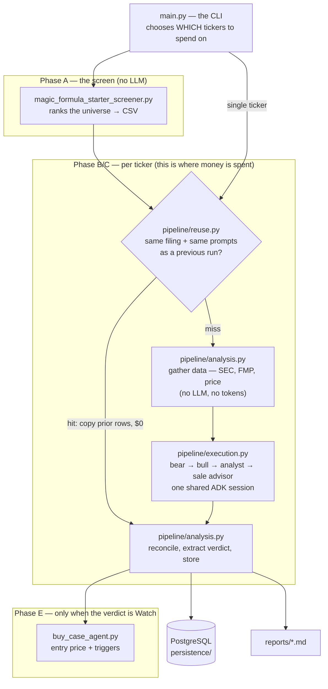
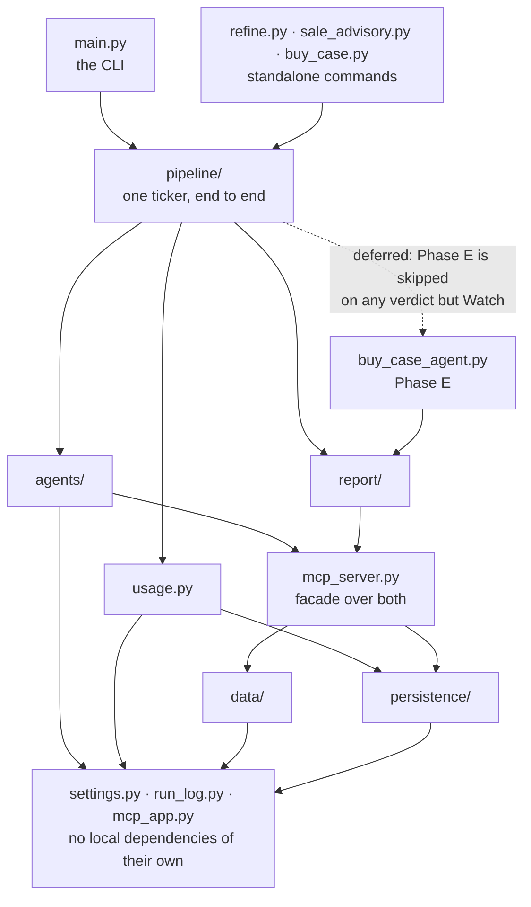
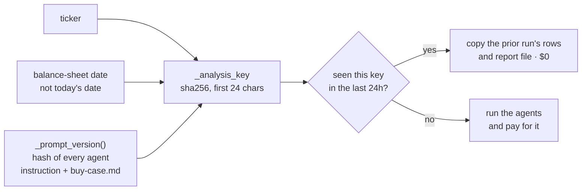
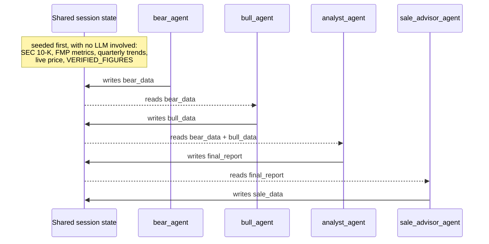
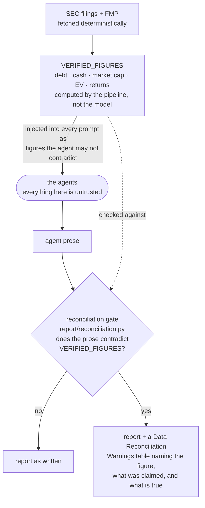

# Architecture

What this system is, what runs when, and why the pieces are separated where they
are. Read this before the numbered walkthroughs — they explain *how* each part
works, this explains *what the parts are*.

For where a given file lives, see [00-module-map.md](00-module-map.md). For the
original design intent (authored before the code, as a spec-driven artifact), see
[`src/specs/agent_architecture.md`](../src/specs/agent_architecture.md).

## What it does

It screens the stock market for companies that are cheap, well-run, and growing;
then, for the top ~30, it argues both sides of the case with LLM agents, has a
neutral judge write a verdict, and stores a report a non-specialist can read. It
records what each verdict claimed so the system can later be graded on what
actually happened.

It is a **research tool that produces documents**. It places no trades and holds no
positions. (Positions live in a separate repo that shares the database.)

## The shape of a run

Two later phases run **outside** a pipeline run, from their own commands:

- **Phase D**, the critic loop (`refine.py`) — an independent critic challenges a
  stored report and the analyst revises it, up to a round and spend ceiling.
- **Phase C repair** (`sale_advisory.py`) and **buy-case repair** (`buy_case.py`) —
  regenerate one section of an existing report.

## The layers, and what separates them

The package boundaries are not arbitrary; each one answers a different question.

| Layer | Question it answers | Talks to |
| :--- | :--- | :--- |
| `data/` | What is true about this company? | FMP, SEC EDGAR, Tavily |
| `persistence/` | What did we say, and when? | PostgreSQL |
| `agents/` | What is each role told, and how is a turn run? | Google ADK / Gemini |
| `pipeline/` | What does one ticker cost, and what gets written down? | the three above |
| `report/` | How does this read to a human, and does it contradict itself? | one live price quote, nothing else |
| `main.py` | Which tickers, and which mode? | `pipeline` |

**The arrows only point one way**, which is a recent property and worth protecting:

Read the diagram for what is *absent*: **no arrow points back up.** There are no
mutual imports anywhere in `src/` — you can walk this graph top to bottom and never
return to where you started.

That is recent. Until lately `refine`, `buy_case_agent`, `critic_agent` and the rest
all did `import main` to reach the agents, the cost accounting and a configured
logger. Since `main.py` is run as a script it loads under the name `__main__`, so
those imports re-executed the whole file and attached a second set of log handlers;
a `sys.modules` alias papered over it. Everything shared now lives in the lower
boxes, so the alias is gone.

The dotted arrow is not a cycle, just a deferred import. `pipeline` calls
`buy_case_agent` inside the function because most runs never reach Phase E — a `Buy`
or an `Avoid` verdict skips it — and there is no reason to make every importer of
`pipeline` load it. It *was* a cycle until `_with_run_header`, the one thing
`buy_case_agent` needed from `pipeline`, moved to `report/provenance.py`. Nothing
about prepending a banner to a string belonged to the pipeline.

Three layers are worth dwelling on.

**`report/` imports nothing from the pipeline.** It turns a candidate dict and a
price dict into text. (It reaches out exactly once, for the live quote in
`report/price.py` — fetching sits beside formatting there on purpose, so the price
on the report and the price the buy triggers are measured against cannot be two
numbers taken seconds apart.) This is what makes report output testable
without standing up a run — `tools/snapshot_report_surface.py` renders every section
over a fixture corpus offline. It matters because report text is not cosmetic: it is
stored in the database, injected into agent prompts, and hashed into the reuse
fingerprint.

**`data/` and `persistence/` are split so imports stay cheap.** They were one
2,458-line module. A cron job that only writes a row was paying to import edgartools
and pandas; one that only wants a price was paying for psycopg2 and 350 lines of
DDL. Importing `persistence` alone now takes 0.9s against `mcp_server`'s 2.4s.

**`main.py` is only the CLI.** The split between it and `pipeline/` is the split
between deciding what to spend on and spending it.

## Two things that are really about money

This system's failure modes are expensive rather than loud, so two mechanisms exist
purely to bound cost. Both are documented fully in
[05-guardrails-cost-and-reuse.md](05-guardrails-cost-and-reuse.md).

**The reuse fingerprint** (`pipeline/reuse.py`). A 30-ticker run costs about $11, and
the same filing analysed twice is the same analysis. So before any billed work:

The **balance-sheet date** rather than today's is the crux: two runs a day apart
against the same filing should be one analysis, while a new filing must force a
fresh one. Including `_prompt_version()` means editing a prompt correctly
invalidates the cache — and is also why an *accidental* change to it costs real
money.

**The budget guard** (`usage.py`). Token usage is counted per resolved model
version, priced, and checked against per-run and rolling-window ceilings between
tickers — never mid-ticker, since stopping half way leaves a partial analysis you
have already paid for.

## Why the agents are wired the way they are

Each arrow into the session is an `output_key`; each arrow out is a `{key}`
templated into the next agent's instruction. No agent calls another directly.

- **Bear runs before bull** so the bull case can refute a specific argument rather
  than assert a generic one. The analyst is a *third* role with no research tools,
  which keeps the verdict a judgement over two arguments instead of a fourth
  opinion.
- **They share one ADK session** so each role's output is visible to the next by
  session key — but `include_contents="none"` means no agent is re-sent the whole
  prior transcript. That one setting cut a measured run from 183k to 130k input
  tokens.
- **Retries are per agent, not per graph.** A 429 on the analyst re-runs the
  analyst; re-running the graph would re-pay for the bear and bull that already
  succeeded. This is why the graph is a plain Python list rather than ADK's
  `SequentialAgent`.
- **Only the buy-side agents see forward-looking data.** Analyst estimates and the
  earnings calendar are withheld from the bear/bull/analyst chain, which weighs
  realised results; Phase E runs after the verdict, so it can use projections
  without contaminating the verdict that produced them.

## Trust boundaries

Nothing an LLM writes is trusted as fact. Two deterministic gates sandwich them —
one on the way in, one on the way out:

The same numbers do both jobs: they go in as an instruction the agent must not
contradict, and they come back out as the yardstick its prose is measured against.
A disagreement is surfaced *in the report* rather than only logged, because a reader
has no other way to know a figure in the bull case is wrong.

The gate is deliberately narrow: three figures, prose assertions only, with
documented exceptions for changes ("debt rose BY $11B"), other periods ("$24.4B in
2023"), and thresholds ("sell if debt exceeds $6B"). A clean result means "nothing
contradicts our own basis", never "everything here is true".

## Where the state is

- **PostgreSQL** — pipeline runs, agent outputs, final reports, critic memory, the
  verdict ledger, and embeddings for semantic search. Schema in
  [`src/sql-schema.sql`](../src/sql-schema.sql).
- **`src/reports/*.md`** — the human-readable artifacts, one per ticker per phase.
- **`src/logs/run_<stamp>.log`** — one file per process, from `run_log.py`.
- **The rankings CSV** — Phase A's output, and the input to `--from-csv`.

There is no in-memory state that outlives a run, and no server. Every command is a
process that starts, does one job, and exits.
